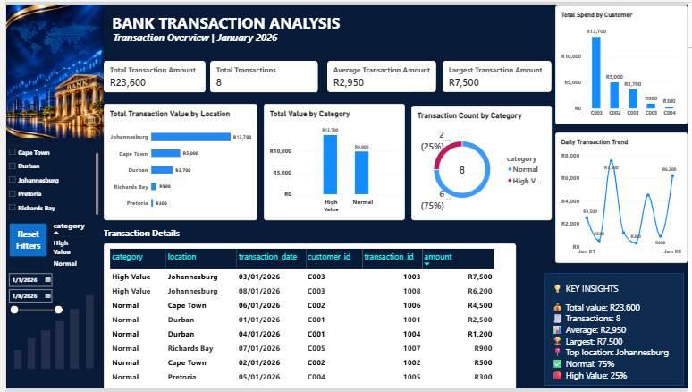

# Bank Transaction Data Pipeline

A Python-based ETL pipeline that extracts, cleans, validates, and loads bank transaction data into PostgreSQL for analysis, with a Power BI dashboard for visual insights.

### Download the Power BI Dashboard

[Download Bank Transaction Dashboard (.pbix)](Bank_Transaction_Dashboard.pbix.pbix)

Open the downloaded file using Microsoft Power BI Desktop.
## Project Overview

This project demonstrates a practical data engineering workflow using Python, pandas, SQLAlchemy, PostgreSQL, SQL, and Power BI.

The pipeline processes transaction data from a CSV file, cleans and validates the records, loads the data into a PostgreSQL database, generates data quality reports, and records pipeline activity through logging.

Power BI is used to present transaction insights in an interactive dashboard.

## Dashboard Preview



*Power BI dashboard built using sample bank transaction data.*

## Technologies Used

- **Python** — pipeline development and data processing
- **pandas** — data cleaning and transformation
- **SQLAlchemy** — database integration
- **PostgreSQL** — relational data storage
- **SQL** — transaction analysis queries
- **Power BI** — dashboard development and visualisation
- **pytest** — automated testing
- **GitHub Actions** — continuous integration and testing

## Key Features

- Extracts transaction data from CSV files
- Removes duplicate records and handles invalid data
- Transforms transaction data for analysis
- Loads processed records into PostgreSQL
- Generates data quality reports
- Logs pipeline execution
- Includes automated tests
- Visualises transaction insights using Power BI

## Project Structure

```text
Bank_Transaction_Data_Pipeline/
├── .github/
│   └── workflows/
├── data/
├── reports/
├── sql/
├── src/
├── tests/
├── dashboard_preview.png
├── requirements.txt
└── README.md
```

## Purpose

The purpose of this project is to develop practical skills in data engineering, database integration, SQL analytics, data quality, automated testing, and data visualisation.

## Disclaimer

This is an educational portfolio project using sample transaction data. It is not affiliated with any financial institution and does not represent real customer banking information.

